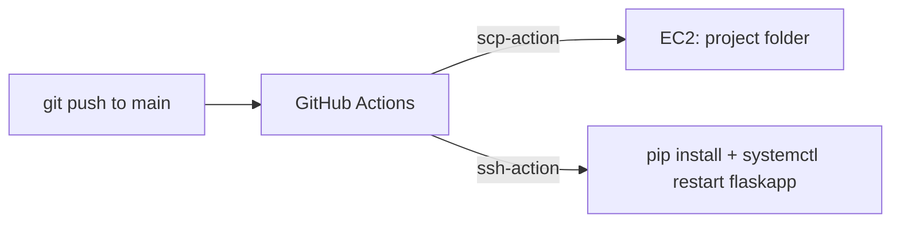

# Flask EC2 GitHub Actions Deploy

A minimal Flask dashboard page that is automatically deployed to an AWS EC2 instance by a GitHub Actions CI/CD workflow on every push to `main`.

## What it does
`app.py` serves a single route (`/`) that renders `templates/index.html` with the server hostname and current time. The real point of the repo is the pipeline in `.github/workflows/deploy.yml`, which copies the code to EC2 over SCP and restarts the app via SSH.

## Key features
- Push-to-deploy: workflow triggers on pushes to `main`.
- `appleboy/scp-action` copies the repo to the EC2 host (cleaning the target directory first, `rm: true`).
- `appleboy/ssh-action` installs `requirements.txt` and restarts a `flaskapp` systemd service.
- Credentials are kept in GitHub Secrets, not in the repo.

## Tech stack
Python, Flask, Gunicorn (listed in requirements), Bootstrap-styled HTML template, GitHub Actions, AWS EC2 + systemd.

## Flow


## Project structure
```
.github/workflows/deploy.yml   # CI/CD workflow
templates/index.html           # dashboard template
app.py                         # Flask app (host 0.0.0.0, port 5000)
requirements.txt               # flask, gunicorn
```

## Setup
1. Prepare an Ubuntu EC2 instance with Python 3 and a systemd unit named `flaskapp` that runs the app (the unit file is not in this repo).
2. In the GitHub repo add secrets: `EC2_HOST`, `EC2_USER`, `EC2_SSH_KEY`.
3. Edit `deploy.yml`: the target path and `cd` still use the placeholder `your-repo-name`; replace it with your real directory.
4. Push to `main`.

Local run:
```bash
pip install -r requirements.txt
python app.py   # http://localhost:5000
```

## Limitations / future work
- Workflow still contains the `your-repo-name` placeholder.
- No tests, no systemd unit file or provisioning script included.
- Uses `pip3 install --break-system-packages` rather than a virtualenv.
- README references a LICENSE file that is not in the repo.
